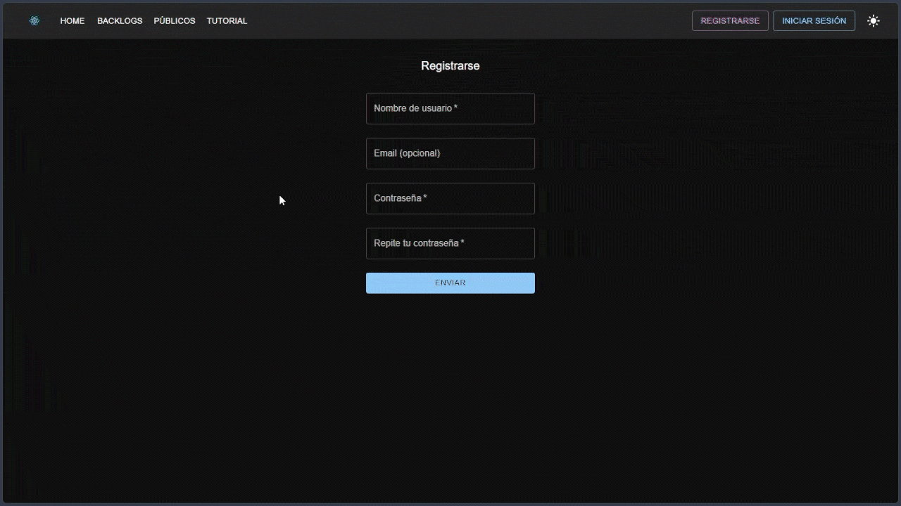
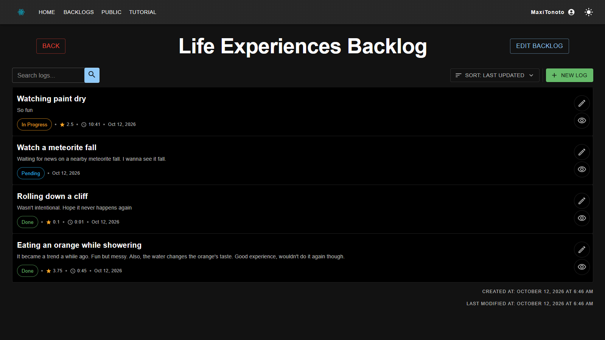
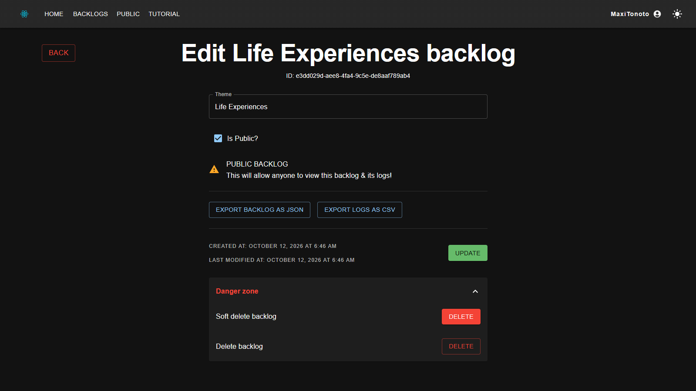
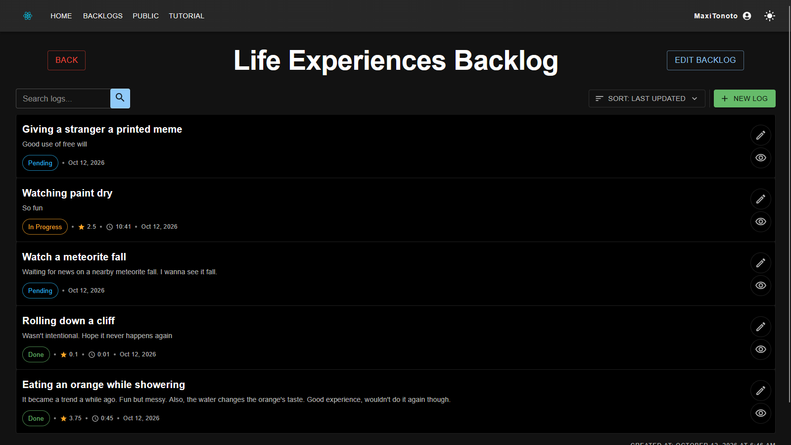
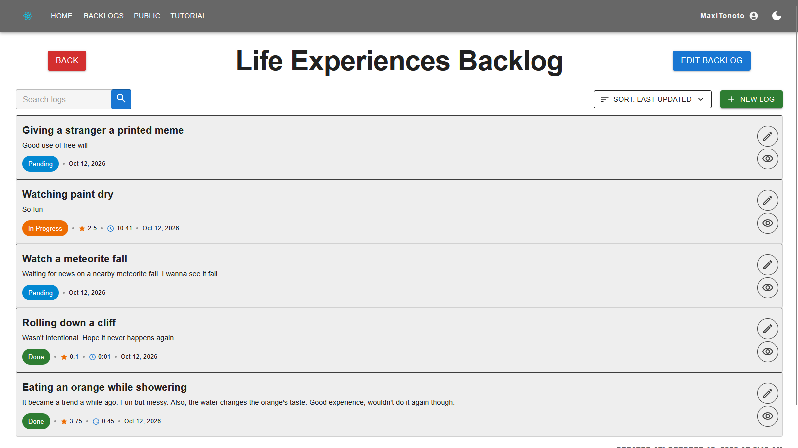
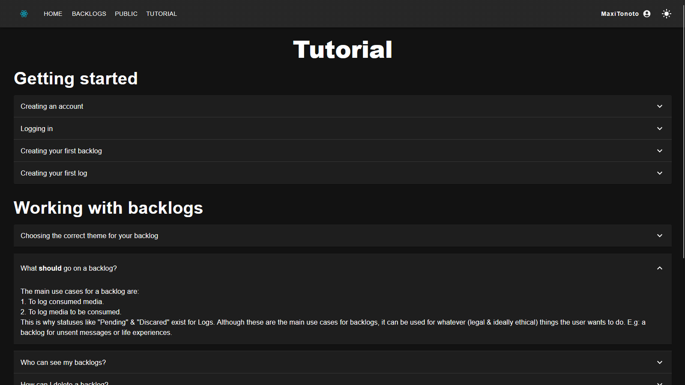

# Logobbo

**Create backlogs for everything!**

[Screenshots](#screenshots) · [Tech stack](#tech-stack) · [About this repository](#about-this-repository)

---

## What's a "Backlog"?

A backlog is a registry of (usually) media that has been consumed, or is yet to be consumed. It is commonly used by gaming enthusiasts to keep track of games that have been (and/or are to be) played, although the theme is up to the user's choice. It can be as broad as "Games Backlog" to something as specific as "Steam Discount Games That Would Otherwise Sit On The Library Backlog".
Backlog entries are named "Logs".

## Why Logobbo?

Many people use tools such as spreadsheets to keep their backlogs. While that's not wrong, a dedicated platform can offer backlog-specific utilities. That's what Logobbo aims to provide.

## Screenshots

### Backlog

### Creating a Log

### Backlog edit

### Dark / Light themes

### Tutorial

## Features

- Create and manage backlogs for video games and other kinds of media.
- User accounts with JWT authentication.
- Dark and light themes.
- i18n translations.
- Feedback for loading and empty listings.
- Export Backlogs & Logs in JSON and CSV.
- Public Backlogs.

## Tech stack

| Layer        | Technologies                                                             |
| ------------ | ------------------------------------------------------------------------ |
| **Frontend** | TypeScript, React, MUI (Material UI), React-Toastify, Vite, Bun, i18next |
| **Backend**  | Python, Django, Django REST Framework                                    |
| **API**      | RESTful, HATEOAS                                                         |
| **Auth**     | JWT (DRF Simple JWT)                                                     |

### Highlights

- **REST API following RESTful and HATEOAS standards**.
- **JWT authentication stored in `httpOnly` cookies.** The frontend uses `access_token` and `refresh_token` cookies, which protects the tokens from XSS (Cross-Site Scripting) attacks.
- Built on Django's standard `User` model (unique username, password, optional email).

## About this repository

The source code of Logobbo lives in a **private repository**. This public repo exists to showcase the project: what it does, how it looks, and the technologies behind it.

If you are a recruiter or reviewer and would like to see the code, please ask for access. I'm happy to provide it!

## Roadmap

- [x] Empty update (better loading and empty listings feedback)
- [x] Visual update (UI/UX improvements)
- [x] Themes update (dark/light modes)
- [ ] **IN PROGRESS:** Profiles update (search profiles, view public backlogs)
- [ ] Branding update (replace placeholder images, add logos)
- [ ] Translations update (i18n instead of hard-coded text)

## Author

- GitHub: [@MaxiTonoto](https://github.com/MaxiTonoto)
